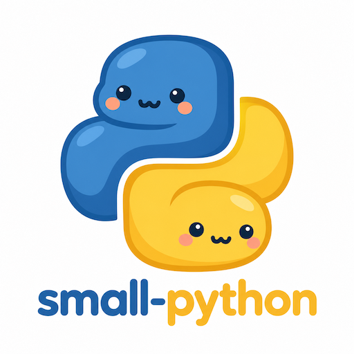

# Small Python

Small Python is a small and embeddable Python runtime.



## Features

* Small, just a few C files, no external dependencies.
* No Python Libs. Attach your own modules.
* Almost complete Python 3.15 support.
* Securely run code generated by AI.
* Can compile Python code to executables with no external dependency.
* GC uses reference couting with cycle removal.

## Build

Requires Python 3.12 or newer. Manage the project with [uv](https://docs.astral.sh/uv/):

```sh
uv sync --locked
uv run python -c "import small_python"
uv build
```

## Publishing

The workflow in `.github/workflows/publish.yml` builds and publishes to PyPI when
a version tag matching `pyproject.toml` is pushed (for example, `v0.0.1`).

For releases, preview a version bump:

```sh
uv run python scripts/bumpversion.py patch
```

Use `major`, `minor`, or `patch`. The script clones `origin` into a temporary
directory, bumps the version and lockfile, builds and checks the distributions,
and displays the changes. Add `-y` to commit, tag, and push the release:

```sh
uv run python scripts/bumpversion.py patch -y
git pull --ff-only
```

Releases use the remote `main` branch; push any intended changes before running
the script. The working checkout is left untouched.
