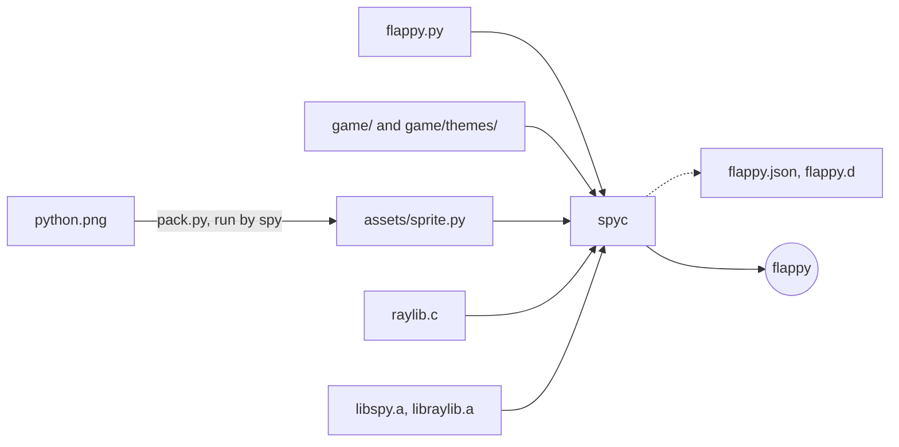

# Flappy Python

Flap a python between the pipes. The game shows what [`spyc`](../../docs/build.md)
does: it bundles a program's modules, data, and dynamically imported code,
and compiles them with a C module, the engine, and raylib into a single
executable.
Copy `flappy` anywhere and it runs, with no Python file, image, or raylib
library beside it.

## Run

Install raylib and pkg-config, then build and run from the repository root:

```sh
brew install raylib pkg-config    # Debian/Ubuntu: apt install libraylib-dev pkg-config
make -C examples/flappy run
```

| Key | Action |
| --- | --- |
| Space, Up, W, or left click | Flap; start a run; fly again after a crash |
| Esc | Quit |

Every ten points the sky changes: day, dusk, then night. A run of 10, 20, 30,
or 40 points earns a medal.

## How it is built



1. `pack.py` turns the sprite into a module, `assets/sprite.py`, holding its
   bytes. It runs on the engine itself (`../../spy pack.py`), so the build
   needs no other Python. `assets` has no `__init__.py`: it is a namespace
   package, which spyc bundles as the engine finds it.
2. One command builds the game:

   ```sh
   spyc -D 'game.themes.*' --minify --metafile flappy.json --deps flappy.d --analyze \
       -o flappy flappy.py raylib.c -- RAYLIB-FLAGS
   ```

   spyc follows the imports from `flappy.py` and embeds each source,
   compiles `raylib.c` as the module `raylib`, and links them with
   `libspy.a` and what follows `--`: raylib's headers, its static library,
   and the system libraries it needs. It also writes `flappy.json` (a
   metafile, as esbuild's), `flappy.d` (a make rule, so editing any bundled
   file or `raylib.c` rebuilds), and the sizes to stderr. On macOS,
   `otool -L flappy` lists only system frameworks.

## What the game uses

| File | Shows |
| --- | --- |
| `flappy.py` | The entry. `from game import *` brings the names in `game.__all__`, including the submodule `tuning`, which spyc bundles because the list is literal. |
| `game/__init__.py`, `bird.py`, `pipes.py`, `world.py`, `collide.py`, `motion.py` | Game rules in a package with relative imports. None imports raylib, so they run on plain `spy` too. `world.py` is a `match` state machine. |
| `game/tuning.py` | A guarded import: `from .custom import *` inside `try`/`except ImportError`. Without `game/custom.py`, spyc leaves it out and the metafile records it as missing; add the file (say `GAP = 230`) and the next build bundles it. |
| `game/themes/` | Dynamic imports. `for_score` computes `game.themes.<name>` for `__import__`, which spyc cannot follow; it warns at that line, and `-D 'game.themes.*'` includes every theme. A new theme is a new file in `NAMES`. |
| `game/medals.py` | A lazy import (PEP 810): `render.py` says `lazy from . import medals`, so the module first runs at the first game over. |
| `game/sounds.py` | The flap's chirp and the crash, synthesized as 16-bit PCM when the game starts, so no audio file ships either. The world reports `flap` and `hit` events; `flappy.py` plays them. |
| `game/render.py` | Drawing with raylib, and the sprite from `assets.sprite`. |
| `raylib.c` | The `raylib` C module. spyc compiles it in and registers it before `flappy.py` runs. |

`python.png` is the project logo without its title, on a transparent
background.

## The `raylib` module

As in [pong](../pong), numbers may be `int` or `float`, and colors are
`(r, g, b)` or `(r, g, b, a)` tuples.

| Python | raylib |
| --- | --- |
| `init_window(w, h, title)` | `InitWindow`, with MSAA and vsync |
| `set_target_fps(fps)` | `SetTargetFPS` |
| `window_should_close()`, `close_window()` | `WindowShouldClose`, `CloseWindow` (which also unloads textures and sounds) |
| `get_frame_time()`, `get_random_value(lo, hi)` | `GetFrameTime`, `GetRandomValue` |
| `is_key_pressed(key)`, `is_mouse_button_pressed(button)` | `IsKeyPressed`, `IsMouseButtonPressed` |
| `begin_drawing()`, `end_drawing()`, `clear_background(color)` | `BeginDrawing`, `EndDrawing`, `ClearBackground` |
| `draw_rectangle(x, y, w, h, color)`, `draw_circle(x, y, r, color)` | `DrawRectangleRec`, `DrawCircleV` |
| `draw_text(text, x, y, size, color)`, `measure_text(text, size)` | `DrawText`, `MeasureText` |
| `load_texture(png)` | `LoadImageFromMemory` and `LoadTextureFromImage`: a texture from PNG bytes, as an index |
| `draw_texture(texture, x, y, height, angle)` | `DrawTexturePro`, centered on `(x, y)`, scaled to `height`, turned `angle` degrees |
| `init_audio_device()` | `InitAudioDevice` |
| `load_sound(pcm, rate)` | `LoadSoundFromWave`: a sound from 16-bit little-endian mono samples, as an index |
| `play_sound(sound)` | `PlaySound` |

Constants: `KEY_SPACE`, `KEY_UP`, `KEY_W`, `MOUSE_BUTTON_LEFT`.
